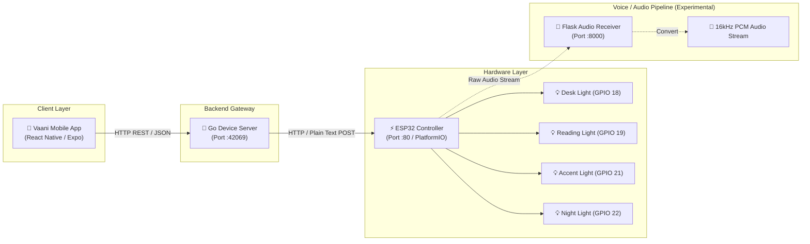

# Vaani 🎙️💡

[](LICENSE)
[](https://www.espressif.com/)
[](https://go.dev/)
[](https://expo.dev/)

**Vaani** (meaning *Voice* in Sanskrit/Hindi) is an end-to-end IoT smart lighting automation ecosystem. It connects a cross-platform mobile application to an ESP32 microcontroller through an intermediate Go API gateway, featuring support for remote LED control, device management, custom trigger words, and hardware audio streaming for voice automation.

---

## 🏛️ System Architecture



---

## 📁 Repository Structure

```text
Vaani/
├── Vaani/              # ESP32 firmware (PlatformIO / C++)
│   ├── src/
│   │   └── main.cpp    # Wi-Fi setup, WebServer on port 80, GPIO toggling
│   └── platformio.ini  # PlatformIO configuration for NodeMCU-32S
├── server/             # Go REST API gateway
│   ├── go.mod
│   └── main.go         # Device state manager & ESP32 HTTP client
├── vaani-app/          # Mobile application (Expo / React Native)
│   ├── src/
│   │   ├── api/        # API client for Go backend
│   │   ├── app/        # Expo Router screens (Home, Device details)
│   │   └── constants/  # Theme & UI styling tokens
│   └── package.json
├── test-servers/       # Audio stream testing utilities
│   ├── server.py       # Flask server capturing raw 16-bit PCM chunks
│   └── convert.py      # WAV converter script (16kHz mono)
└── LICENSE             # MIT License
```

---

## 🔌 Hardware Configuration

| Device ID | Default Name | Wake / Trigger Word | GPIO Pin | Initial State |
|:---------:|:-------------|:--------------------|:--------:|:-------------:|
| **1**     | Desk Light   | `Prism`             | GPIO 18  | OFF           |
| **2**     | Reading Light| `Halo`              | GPIO 19  | OFF           |
| **3**     | Accent Light | `Ember`             | GPIO 21  | OFF           |
| **4**     | Night Light  | `Nova`              | GPIO 22  | OFF           |

*Target Microcontroller*: NodeMCU-32S (ESP-WROOM-32).

---

## 🚀 Getting Started

### 1. Flash the ESP32 Firmware

1. Install [PlatformIO](https://platformio.org/) in VS Code or CLI.
2. Open [`Vaani/src/main.cpp`](Vaani/src/main.cpp) and set your Wi-Fi credentials:
   ```cpp
   const char* WIFI_SSID = "YOUR_WIFI_SSID";
   const char* WIFI_PASSWORD = "YOUR_WIFI_PASSWORD";
   ```
3. Connect your ESP32 board via USB.
4. Build and upload:
   ```bash
   cd Vaani
   pio run --target upload
   pio device monitor
   ```
5. Note the assigned ESP32 IP address printed on the serial monitor (e.g., `192.168.1.100`).

---

### 2. Run the Go API Server

1. Update the `esp32URL` in [`server/main.go`](server/main.go) with your ESP32's IP address:
   ```go
   esp32URL = "http://<ESP32-IP>/led"
   ```
2. Start the server:
   ```bash
   cd server
   go run main.go
   ```
   *By default, the server runs on port `42069` (override using the `PORT` environment variable).*

---

### 3. Launch the Mobile App

1. Ensure the `API_BASE_URL` in [`vaani-app/src/api/led.ts`](vaani-app/src/api/led.ts) points to your Go server's LAN IP address:
   ```typescript
   const API_BASE_URL = 'http://<YOUR-COMPUTER-LAN-IP>:42069';
   ```
2. Install dependencies and start Expo:
   ```bash
   cd vaani-app
   npm install
   npx expo start
   ```
3. Scan the QR code with **Expo Go** (Android / iOS) or press `w` to open in a web browser.

---

### 4. Voice / Audio Stream Testing (Optional)

The `test-servers/` directory contains tools to verify microphone streaming from the ESP32:

1. **Start the audio receiver:**
   ```bash
   cd test-servers
   python server.py
   ```
2. **Convert recorded raw PCM to WAV:**
   ```bash
   python convert.py
   ```
   *Output*: `test-servers/audio.wav` (16kHz, 16-bit signed PCM, Mono).

---

## 📡 API Reference

### Go Backend API (`http://localhost:42069`)

- **`GET /health`**
  - Check if the backend gateway is running.
- **`GET /api/devices`**
  - List all configured smart devices with their current states and assigned wake words.
- **`GET /api/devices/:id`**
  - Retrieve details for a specific device (`1`-`4`).
- **`PATCH /api/devices/:id`**
  - Rename a device.
  - Body: `{"name": "New Device Name"}`
- **`POST /api/led`**
  - Toggle light state.
  - Body: `{"device": 1, "action": "ON"}` (Actions: `"ON"` | `"OFF"`)

### ESP32 Direct HTTP Endpoint (`http://<ESP32-IP>:80`)

- **`POST /led`**
  - Direct endpoint called by the Go server.
  - Plaintext body:
    ```text
    device:1
    action:ON
    ```

---

## 📄 License

This project is licensed under the [MIT License](LICENSE) - see the LICENSE file for details.
