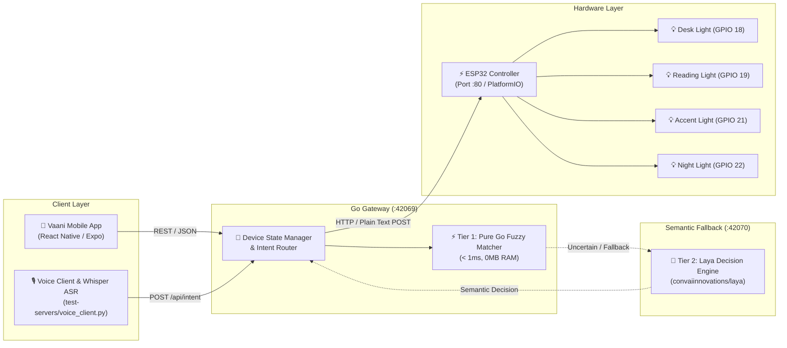

# Vaani 🎙️💡

[](LICENSE)
[](https://www.espressif.com/)
[](https://go.dev/)
[](https://expo.dev/)

**Vaani** (meaning *Voice* in Sanskrit/Hindi) is an end-to-end IoT smart lighting automation ecosystem. It connects a cross-platform mobile application to an ESP32 microcontroller through an intermediate Go API gateway, featuring support for remote LED control, device management, custom trigger words, and hardware audio streaming for voice automation.

---

## 🏛️ System Architecture



---

## 📁 Repository Structure

```text
Vaani/
├── Vaani/              # ESP32 firmware (PlatformIO / C++)
│   ├── src/
│   │   └── main.cpp    # Wi-Fi setup, WebServer on port 80, GPIO toggling
│   └── platformio.ini  # PlatformIO configuration for NodeMCU-32S
├── server/             # Go REST API gateway & intent parser
│   ├── go.mod
│   ├── main.go         # Device state manager & HTTP router
│   ├── intent.go       # Intent classification & domain resolution
│   ├── fuzzy.go        # Levenshtein distance & text normalization algorithms
│   ├── semantic.go     # Hybrid Tier-2 semantic fallback gateway (Laya / SLM)
│   ├── intent_test.go  # Intent parser unit test suite
│   ├── fuzzy_test.go   # Fuzzy logic unit test suite
│   └── semantic_test.go# Semantic fallback unit test suite
├── vaani-app/          # Mobile application (Expo / React Native)
│   ├── src/
│   │   ├── api/        # API client for Go backend
│   │   ├── app/        # Expo Router screens (Home, Device details)
│   │   └── constants/  # Theme & UI styling tokens
│   └── package.json
├── test-servers/       # Audio stream testing utilities
│   ├── server.py       # Flask server receiving ESP32 PCM chunks & WAV converter
│   ├── voice_client.py # Interactive laptop mic client with Whisper ASR & playback review
│   └── semantic_server.py # Tier-2 local semantic decision server (Laya / heuristics)
├── CHANGELOG.md        # Detailed version history and changes
└── LICENSE             # MIT License
```

---

## 🔌 Hardware Configuration

| Device ID | Default Name | Wake / Trigger Word | GPIO Pin | Initial State |
|:---------:|:-------------|:--------------------|:--------:|:-------------:|
| **1**     | Desk Light   | `Prism`             | GPIO 18  | OFF           |
| **2**     | Reading Light| `Halo`              | GPIO 19  | OFF           |
| **3**     | Accent Light | `Ember`             | GPIO 21  | OFF           |
| **4**     | Night Light  | `Nova`              | GPIO 22  | OFF           |

*Target Microcontroller*: NodeMCU-32S (ESP-WROOM-32).

---

## 🚀 Getting Started

### 1. Flash the ESP32 Firmware

1. Install [PlatformIO](https://platformio.org/) in VS Code or CLI.
2. Open [`Vaani/src/main.cpp`](Vaani/src/main.cpp) and set your Wi-Fi credentials:
   ```cpp
   const char* WIFI_SSID = "YOUR_WIFI_SSID";
   const char* WIFI_PASSWORD = "YOUR_WIFI_PASSWORD";
   ```
3. Connect your ESP32 board via USB.
4. Build and upload:
   ```bash
   cd Vaani
   pio run --target upload
   pio device monitor
   ```
5. Note the assigned ESP32 IP address printed on the serial monitor (e.g., `192.168.1.100`).

---

### 2. Run the Intent Parsing & Gateway Stack

#### A. (Optional) Start the Tier-2 Semantic Decision Server:
For parsing complex, colloquial, or ambient speech (*"it's getting dark"*, *"make it brighter"*):
```bash
python3 test-servers/semantic_server.py
```
*Listens on `http://127.0.0.1:42070` using the local Laya decision model (`convaiinnovations/laya`).*

#### B. Start the Go Backend Gateway:
1. Update the `esp32URL` in [`server/main.go`](server/main.go) with your ESP32's IP address:
   ```go
   esp32URL = "http://<ESP32-IP>/led"
   ```
2. Run the automated test suite (verifies fuzzy parsing, device priorities, polarity guards, and semantic fallbacks):
   ```bash
   cd server
   go test -v ./...
   ```
3. Start the server:
   ```bash
   go run .
   ```
   *Runs on port `42069` (override using the `PORT` environment variable).*

---

### 3. Launch the Mobile App

1. Ensure the `API_BASE_URL` in [`vaani-app/src/api/led.ts`](vaani-app/src/api/led.ts) points to your Go server's LAN IP address:
   ```typescript
   const API_BASE_URL = 'http://<YOUR-COMPUTER-LAN-IP>:42069';
   ```
2. Install dependencies and start Expo:
   ```bash
   cd vaani-app
   npm install
   npx expo start
   ```
3. Scan the QR code with **Expo Go** (Android / iOS) or press `w` to open in a web browser.

---

### 4. Voice Testing with Laptop Mic or ESP32 Audio

#### A. Interactive Mic Voice Client (Record $\rightarrow$ Review/Playback $\rightarrow$ Whisper $\rightarrow$ Go Server):
Test spoken commands directly using your laptop microphone with audio review:
```bash
python test-servers/voice_client.py
```
* **Features:**
  - Automatically saves each recording to `test-servers/recorded_cmd.wav`.
  - Press `p` to listen back through your speakers/headphones to verify speech clarity before submitting.
  - Press `s` (or Enter) to transcribe with Whisper and dispatch to the Go intent parser.
  - Press `r` to re-record if background noise interrupted your speech.
  - Interactive confirmation prompt (`👉 Execute this proposal? [y/N]`) for scene proposals requiring verification.
  - Or process any existing `.wav` file directly: `python test-servers/voice_client.py --file my_sample.wav`.
  - Add `--execute` to trigger real ESP32 GPIO actions, or leave default for dry-run parsing.

#### B. ESP32 Audio Streaming (Raw PCM Capture & Conversion):
Verify raw audio streaming from an ESP32 microphone:
1. **Start the audio receiver:**
   ```bash
   cd test-servers
   python server.py
   ```
2. **Convert recorded raw PCM to WAV:**
   ```bash
   python server.py --convert
   ```
   *(Or query `GET http://<IP>:8000/convert` while the server is running).*  
   *Output*: `test-servers/audio.wav` (16kHz, 16-bit signed PCM, Mono).

---

## 📡 API Reference

### Go Backend API (`http://localhost:42069`)

- **`GET /health`**
  - Check if the backend gateway is running.
- **`GET /api/devices`**
  - List all configured smart devices with their current states and assigned wake words.
- **`GET /api/devices/:id`**
  - Retrieve details for a specific device (`1`-`4`).
- **`PATCH /api/devices/:id`**
  - Rename a device.
  - Body: `{"name": "New Device Name"}`
- **`POST /api/led`**
  - Toggle light state directly by device ID.
  - Body: `{"device": 1, "action": "ON"}` (Actions: `"ON"` | `"OFF"`)
- **`POST /api/intent`**
  - Parse and execute natural voice commands using the **2-Tier Hybrid Decision Engine**.
  - Body:
    ```json
    {
      "text": "turn on prism",
      "execute": true,
      "confirmed": false
    }
    ```
  - **Intents Supported**: `TURN_ON`, `TURN_OFF`, `TOGGLE`, `ALL_ON`, `ALL_OFF`, `QUERY_STATUS`, `MULTI_ACTION`.
  - **Multi-Device & Compound Commands**:
    - **Uniform Multi-Device**: Commands like *"turn on ember and halo"* turn ON all specified devices in a single request.
    - **Opposing Compound Actions**: Commands with opposing actions (e.g. *"turn off ember turn on halo"* or *"ember off halo on"*) resolve as `MULTI_ACTION` (`Action: "MULTI"`), mapping specific individual actions per device via `deviceActions: {"3": "OFF", "2": "ON"}` and dispatching them accordingly to the ESP32.
  - **Safety & Guardrails**:
    - **Device Priority**: Individual candidate devices are matched *before* global keywords to prevent false room-wide triggers (e.g. *"turn on all night lights"* resolves to Night Light, not all lights).
    - **Determiner Guard**: Bare `"on"` / `"off"` requires trailing placement or absence of determiners, avoiding false actions from prepositional phrases (*"put the book on the desk"*).
    - **Polarity Cross-Check**: Brightening phrases (*"dark"*, *"brighten"*) cannot trigger `TURN_OFF`.
    - **Out-of-Scope Refusal**: Unregistered devices (*"bathroom light"*, *"kitchen light"*) safely reject rather than widening to all lights.
    - **Confirmation-Before-Act**: Bedtime scenes (*"time for sleep"*) return `requiresConfirmation: true` and hold execution until `confirmed: true` is supplied.
    - **Execution Gating**: Refuses execution if combined confidence ($\min(\text{actionConf}, \text{deviceConf})$) $< 0.70$.
  - Response:
    ```json
    {
      "success": true,
      "message": "Parsed intent: TURN_ON (confidence: 1.00)",
      "intent": {
        "intent": "TURN_ON",
        "action": "ON",
        "deviceIds": [1],
        "targetName": "Desk Light",
        "confidence": 1.0,
        "rawText": "turn on prism",
        "requiresConfirmation": false
      },
      "executed": true,
      "requiresConfirmation": false,
      "results": [
        {"device": 1, "name": "Desk Light", "gpio": 18, "state": "ON", "success": true}
      ]
    }
    ```

### ESP32 Direct HTTP Endpoint (`http://<ESP32-IP>:80`)

- **`POST /led`**
  - Direct endpoint called by the Go server.
  - Plaintext body:
    ```text
    device:1
    action:ON
    ```

---

## 📄 License

This project is licensed under the [MIT License](LICENSE) - see the LICENSE file for details.
